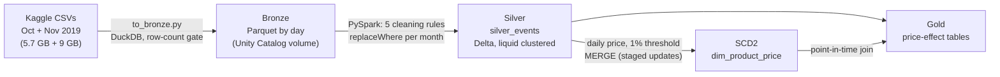

# Retail Clickstream Lakehouse

A medallion lakehouse on **Databricks (PySpark + Delta Lake)** built on **110 million real e-commerce events**,
with an **SCD Type 2 price history** loaded incrementally via **Delta MERGE**, and an analysis of one business
question:

> **Did price changes change what customers bought?**

**Short answer:** yes, strongly. Measured against a control group of unchanged products, a 10%+ price drop lifted
daily purchases **1.43x** in October and about **2x** on Black Friday. A metric that looked at conversion alone
suggested the opposite, which is part of the story below.

---

## Architecture



| Layer | Table / location | What it holds |
|---|---|---|
| **Bronze** | `/Volumes/workspace/retail/landing/bronze/events/event_date=…` | Raw events exactly as received, as Parquet partitioned by day, plus `_source_file` and `_ingested_at` |
| **Silver** | `workspace.retail.silver_events` | Deduplicated, typed and cleaned events (Delta, liquid clustering on `event_date`) |
| **SCD2** | `workspace.retail.dim_product_price` | One row per product price version: `valid_from`, `valid_to`, `is_current`, surrogate `price_key` |
| **Gold** | `gold_product_version_stats`, `gold_price_changes`, `gold_product_daily`, `gold_price_effect_did` | Business-ready tables for the price-effect analysis |

---

## Key results

### Pipeline

| Step | Result |
|---|---|
| Bronze (October) | 42,448,764 rows, CSV **5.7 GB to 925 MB** (6x smaller) in 88 s; row-count gate in = out |
| Silver (both months) | **109.8M** rows after removing **130,739** exact duplicates (30,220 Oct + 100,519 Nov); 0 null timestamps |
| Silver file layout | `OPTIMIZE` with liquid clustering: 49 small files to 28 |
| SCD2 (October build) | 2.28M product-days to **251,549 versions** for 165,647 products (1% change threshold) |
| SCD2 (November MERGE) | **51,087 versions closed, 168,330 inserted** (39,768 new products) in one MERGE, about 9 s |
| SCD2 checks | 1 current row per product, unique keys, no gaps or overlaps: **0 violations** |
| Point-in-time join | **All 1,659,703 purchases** (Oct + Nov) match exactly one price version (no fan-out, no gaps) |
| Idempotency | Rerunning the November load leaves silver at exactly 67,401,460 rows; October untouched |

### Analysis

**Price changes vs purchases (October, difference-in-differences).** For 16,034 price changes with enough
traffic, purchases per day in the 7 days before vs after the change, compared with unchanged products in the
same category over the same days:

| Price change | Product's purchases/day | Unchanged neighbours | Lift |
|---|---|---|---|
| Drop 10%+ | +42.1% | -0.3% | **1.43** |
| Drop 1-10% | +6.8% | -0.8% | 1.08 |
| Rise 1-10% | -8.2% | +1.4% | 0.91 |
| Rise 10%+ | -26.0% | +1.3% | **0.73** |

**Black Friday (Nov 29) vs the clean week before.** Only 8% of products were discounted:

| Group | Lift (Black Friday / normal day) |
|---|---|
| Dropped 10%+ | **2.40** |
| Dropped 1-10% | 1.50 |
| Unchanged (control) | 1.18 |
| Rose | 1.11 |

Discounted products were 14% of the products selling that week but drove about **65% of Black Friday's extra
purchases**.

---

## Findings worth knowing

- **The first metric gave the wrong answer.** Measured by conversion (purchases / views), discounts seemed not to
  work: conversion fell after price drops. Discounts attract far more viewers than buyers, so the ratio falls even
  while purchases rise 42%. Switching to purchases per day with a control group reversed the conclusion.
- **44% of discounts reverse**, mostly within about a week. Many products flip between two prices (one product
  changed price 11 times in November), so "sale on, sale off" is a large part of the pricing behaviour.
- **Testing a hypothesis, and dropping it.** I suspected the biggest drops (up to 97%) were glitches. They turned
  out to be rare (27 of 21,810), unique and persistent rather than quick reversals, so they were kept as real data.
- **A tracking outage that passed every check.** Nov 15 has **5.7M views and 0 purchases**, and Nov 17 shows about
  7x normal purchases. Row counts, deduplication, schema and SCD2 checks all passed. The data was *correct* but
  not *plausible*, so volume/anomaly checks are next on the roadmap. The Black Friday baseline avoids Nov 14-17.
- **Profiling drove the cleaning rules:** 31.8% of events have no category and 14.4% no brand. Those rows are kept
  as `"unknown"` rather than dropped; dropping them would have removed 26% of all purchases.

---

## Engineering decisions

- **Bronze changes nothing, only adds** (`event_date`, `_source_file`, `_ingested_at`), so silver can always be
  rebuilt without re-ingesting.
- **Idempotent loads everywhere:** `to_bronze.py` replaces a month's day-folders; silver uses Delta
  `replaceWhere` on the month's date range; the SCD2 MERGE is guarded so a rerun skips instead of duplicating.
- **SCD2 via the staged-updates MERGE pattern:** each incoming row can trigger only one action, so a changed product
  enters twice: once with its real key (matches the current row and closes it) and once with a NULL key (cannot
  match, so the new version is inserted). Unchanged products are not sent at all.
- **Liquid clustering instead of date partitioning** for silver: about 110M rows is too small to justify folder
  partitions, while clustering still lets date filters skip data.
- **Rules in a tested module:** cleaning and SCD2 logic live in `src/retail_lakehouse/transforms.py` with
  14 pytest unit tests. Breaking the code on purpose (swapping `lag` for `lead`) still passed the first 13 tests,
  which exposed a gap; test 14 now catches it.
- **Portable tests:** test DataFrames are built through Arrow, so no PySpark Python workers are needed (they crashed
  on a Windows laptop), and timestamps are formatted inside Spark so results don't depend on the machine's timezone.

---

## How to run

**Local: bronze and tests** (Python 3.12, Java 17)
```bash
python -m venv .venv
.venv/Scripts/python -m pip install -r requirements-dev.txt     # Windows; use .venv/bin/python on Linux/macOS
.venv/Scripts/python to_bronze.py data/raw/2019-Oct.csv         # writes data/bronze/events/event_date=.../
.venv/Scripts/python -m pytest -q                               # 14 tests
```

**Databricks (Free Edition works)**
1. Create the schema and volume: `CREATE SCHEMA workspace.retail; CREATE VOLUME workspace.retail.landing;`
2. Upload bronze with the Databricks CLI:
   `databricks fs cp -r data/bronze/events dbfs:/Volumes/workspace/retail/landing/bronze/events`
3. Run the notebooks in order:

| Notebook | Does |
|---|---|
| `01_profile_bronze` | Profiling: event mix, nulls, duplicates, price changes |
| `02_silver_events` | Silver build (October), liquid clustering, checks |
| `03_dim_product_price` | SCD2 price dimension, invariants, point-in-time join |
| `04_gold_price_effect` | First (conversion-based) analysis |
| `05_price_outliers` | Glitch-or-real investigation of the biggest drops |
| `06_gold_did` | Difference-in-differences with a control group |
| `07_silver_incremental` | November into silver with `replaceWhere`, idempotency test |
| `08_scd2_merge_november` | November SCD2 MERGE (staged updates), checks |
| `09_black_friday` | Daily trend, Black Friday discount lift, tracking outage |

---

## Repository structure

```
retail-lakehouse/
├── to_bronze.py                     # raw CSV -> day-partitioned Parquet, row-count gate
├── src/retail_lakehouse/
│   └── transforms.py                # cleaning rules, daily prices, SCD2 build, SCD2 invariant checks
├── tests/
│   ├── conftest.py                  # local Spark session (UTC, Arrow)
│   └── test_transforms.py           # 14 unit tests
├── notebooks/                       # Databricks notebooks 01-09 (source format, no outputs)
├── requirements-dev.txt
└── pytest.ini
```

---

## Roadmap

- [ ] Gold layer rebuilt as **dbt** models with dbt tests (unique, not null, no-overlap)
- [ ] **Airflow** DAG: bronze, upload, Databricks job, dbt, with monthly backfills
- [ ] **Databricks Asset Bundles** + GitHub Actions CI running pytest and dbt tests on every push
- [ ] **Data-quality gates**, including volume/anomaly checks that would have caught the Nov 15 outage
- [ ] Notebooks import the tested `transforms.py` instead of repeating the rules

---

## Data

"eCommerce behavior data from multi category store" (Kaggle), collected by the Open CDP project.
© original authors, used here for non-commercial learning. **Raw data is not included in this repository**;
only code and aggregated results are published.
